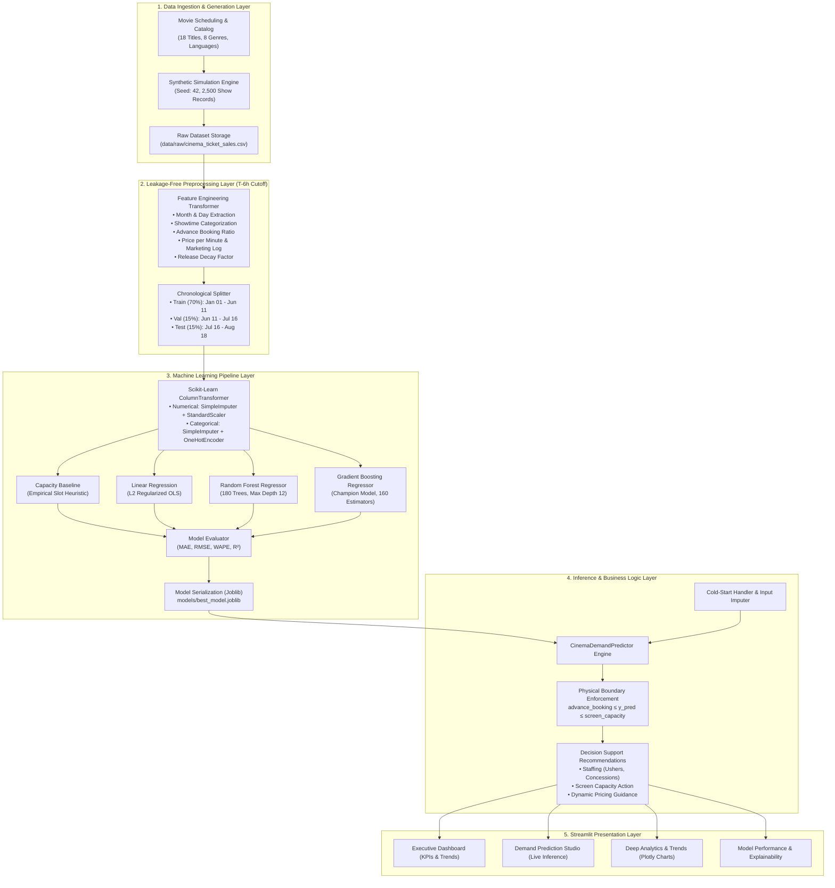
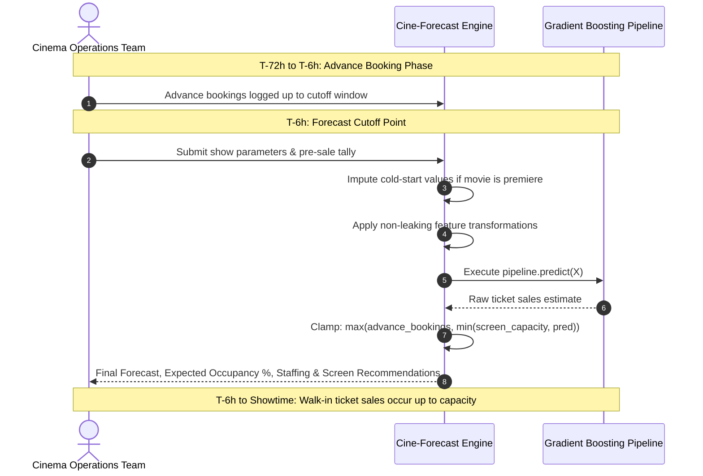

# 🏗️ Cinema Ticket Demand Forecasting: System Architecture

This document outlines the complete architectural design of the Cinema Ticket Demand Forecasting system, from raw show scheduling and feature engineering to model training, evaluation, and interactive Streamlit deployment.

---

## 1. End-to-End System Pipeline

---

## 2. Forecast Horizon & Temporal Integrity

A critical failure mode in demand forecasting is **target leakage** (using features that would not exist when the forecast is made). In our system, the forecast cutoff is strictly defined as **T-6 Hours**:

---

## 3. Directory Layout & Module Responsibilities

| Path | Purpose |
|---|---|
| `data/raw/` | Holds the immutable raw cinema show records. |
| `data/processed/` | Holds strictly chronologically partitioned train, validation, and test sets. |
| `src/data_generation.py` | Reproducible synthetic cinema data generator enforcing business constraints. |
| `src/preprocessing.py` | Feature engineering transformers and temporal split logic. |
| `src/train.py` | Training runner for baseline and Scikit-Learn regressors with artifact export. |
| `src/evaluate.py` | Diagnostic chart generation (residuals, actual vs predicted, feature weights). |
| `src/predict.py` | Production inference class with cold-start fallbacks and operational guardrails. |
| `src/utils.py` | Core calculation metrics (WAPE, MAE, RMSE) and categorizers. |
| `app/app.py` | Streamlit dark-mode multi-page user application. |
| `app/styles.py` | Cinema velvet dark CSS design and Plotly templates. |
| `app/components.py` | Metric cards and UI visual badges. |
| `models/` | Serialized model (`best_model.joblib`), metrics JSON, and diagnostic plots. |
| `tests/` | Pytest automated test suite covering generation, transformers, models, and inference. |
| `notebooks/` | Interactive Jupyter Notebook for exploratory data analysis and visual validation. |
