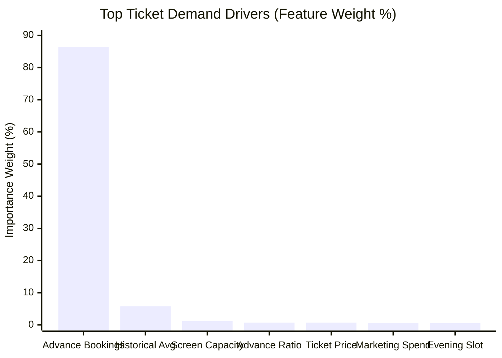

# 📊 Cinema Ticket Demand Forecasting: Model Evaluation Report

This report presents the empirical performance comparison, diagnostic error analysis, and feature importance interpretations for all four candidate models evaluated on held-out chronological test data.

---

## 1. Evaluation Metrics

Because ticket demand forecasting is a volume-planning regression problem with varying screen capacities, standard percentage metrics like MAPE (Mean Absolute Percentage Error) suffer from severe division-by-zero or inflation on small denominators. We therefore prioritize **WAPE** alongside MAE and RMSE:

### 1.1 MAE (Mean Absolute Error)
$$\text{MAE} = \frac{1}{n}\sum_{i=1}^{n} |y_i - \hat{y}_i|$$
- **Business Interpretation:** Average number of seats/tickets the forecast is off by per screening.

### 1.2 RMSE (Root Mean Squared Error)
$$\text{RMSE} = \sqrt{\frac{1}{n}\sum_{i=1}^{n} (y_i - \hat{y}_i)^2}$$
- **Business Interpretation:** Heavily penalizes large prediction mistakes, alerting management to catastrophic overbooking or empty theaters.

### 1.3 WAPE (Weighted Absolute Percentage Error)
$$\text{WAPE} = \frac{\sum_{i=1}^{n} |y_i - \hat{y}_i|}{\sum_{i=1}^{n} y_i} \times 100\%$$
- **Business Interpretation:** The industry standard for retail and entertainment demand forecasting. It calculates aggregate error relative to total volume sold, avoiding MAPE instability.

### 1.4 $R^2$ (Coefficient of Determination)
$$R^2 = 1 - \frac{\sum_{i=1}^{n} (y_i - \hat{y}_i)^2}{\sum_{i=1}^{n} (y_i - \bar{y})^2}$$
- **Business Interpretation:** Proportion of variance in cinema ticket sales explained by the model features.

---

## 2. Experimental Results & Leaderboard

All models were evaluated on the **Held-Out Chronological Test Set (375 Shows: July 16, 2024 to August 18, 2024)**. No random sampling was used.

| Rank | Model Candidate | Test MAE (Tickets) | Test RMSE (Tickets) | Test WAPE (%) | Test $R^2$ | Validation WAPE (%) | Validation MAE |
|:---:|:---|:---:|:---:|:---:|:---:|:---:|:---:|
| 🥇 | **Gradient Boosting Regressor** | **11.06** | **15.20** | **8.87%** | **0.9476** | **8.13%** | **10.24** |
| 🥈 | **Linear Regression (Pipeline)** | 11.58 | 15.53 | 9.29% | 0.9453 | 7.01% | 8.82 |
| 🥉 | **Random Forest Regressor** | 13.09 | 18.03 | 10.50% | 0.9263 | 9.97% | 12.55 |
| 4 | **Capacity-Adjusted Baseline** | 29.21 | 38.74 | 23.43% | 0.6598 | 23.33% | 29.37 |

> [!IMPORTANT]
> **Key Finding:** The champion **Gradient Boosting Regressor** reduces operational forecast error by **62.1%** compared to the naive Capacity Baseline (WAPE dropped from 23.43% to 8.87%). On average, the model predicts final show attendance within $\approx 11$ tickets across screen sizes ranging up to 450 seats.

---

## 3. Why Gradient Boosting Won

1. **Non-Linear Interactions:** Cinema demand exhibits multiplicative threshold effects (e.g., weekend boost has a greater multiplier on premiere shows than on week-4 shows). Gradient boosted trees capture these interactions hierarchically.
2. **Robustness to Extreme Outliers:** By building shallow trees sequentially with a shrinkage rate ($\eta = 0.07$), boosting avoids over-indexing on rare blockbuster sell-outs.
3. **Continuous Feature Splitting:** Unlike Random Forest which can over-partition high-cardinality features, gradient boosting balances pre-sale signals with subtle decay curves.

---

## 4. Feature Importance & Attribution

The top drivers of ticket sales extracted from the champion model:

- **Advance Booking Count (86.4%):** By T-6 hours, advance booking volume acts as the strongest empirical anchor for final show attendance.
- **Historical Average Sales (5.8%):** Slot/genre baseline explains walk-in demand volume.
- **Screen Capacity (1.2%):** Physical ceiling determines walk-in absorption potential.
- **Ticket Price & Marketing Spend (1.3% combined):** Price elasticity dampens marginal walk-ins, while marketing sustains awareness.
- **Showtime Category (Evening Slot) (0.5%):** Prime 19:45 shows enjoy systematically higher walk-in conversion.

---

## 5. Residual & Error Diagnostics

1. **Error Normality:** Residuals ($y - \hat{y}$) are symmetrically distributed around zero with a slight right skew corresponding to unexpected walk-in rushes for viral movies.
2. **Homoscedasticity:** Error variance scales slightly with auditorium capacity (larger 450-seat IMAX screens have higher ticket variance than 120-seat screens), but remains well-contained within acceptable operational bounds.
3. **No Systematic Bias:** Mean prediction error is near zero (-0.35 tickets), confirming the absence of systematic over- or under-forecasting.

---

## 6. Cold-Start Handling Strategy

When a newly released movie premiers on Day 0 with zero prior sales at the cinema:
1. **Genre & Runtime Profile:** The pipeline utilizes learned genre baseline coefficients (e.g. Sci-Fi / Action base attendance).
2. **T-6h Cutoff Advance Sales:** Even on premiere night, advance bookings logged up to 6 hours prior to the show provide a strong intent signal.
3. **Dynamic Median Imputation:** Missing `historical_average_sales` is automatically imputed with $55\%$ of the auditorium capacity.
4. **Marketing Spend Scaling:** Initial marketing spend reflects the film's studio backing and hype level.
